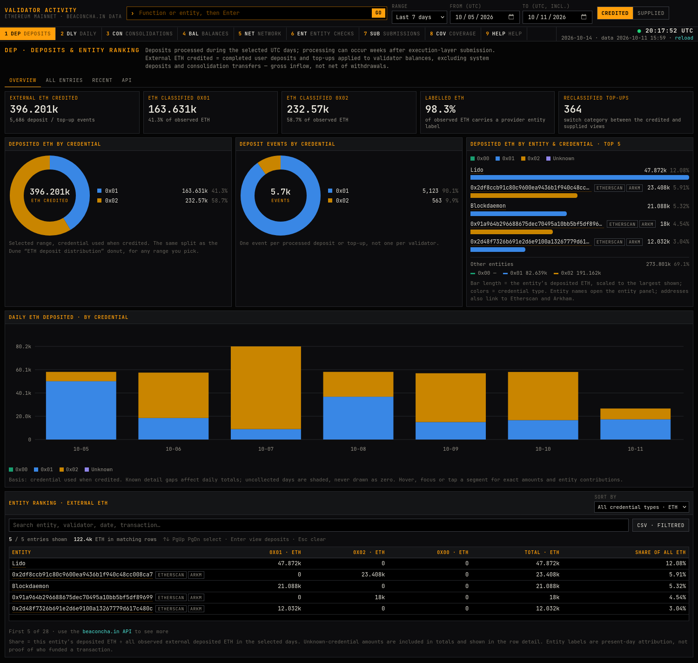

# Validator consolidations (public snapshot)



A keyboard-driven terminal for Ethereum staking activity: external deposits and top-ups, withdrawal credentials (0x00/0x01/0x02), entity attribution, compounding switches and cross-validator consolidations. All data comes from the [beaconcha.in](https://beaconcha.in) API.

This repository holds the site and one aggregate snapshot of the dataset (`site/public/data/summary.json`, window 2026-06-10 → 2026-10-11 UTC). It holds only what the site can show: every table lists at most 5 rows, and only the entities that reach a top 5 under the range presets keep their own figures. All other entities are summed into one "Other entities" row per day, so totals and charts stay exact. Per-day record files (individual deposits, requests, submissions, balances and validator lists) are not included. Use the [beaconcha.in API](https://docs.beaconcha.in) to see more.

```sh
cd site
npm ci
npm run dev        # http://127.0.0.1:5173/ — reads site/public/data, makes no API calls
npm run check      # tsc + vitest + production build
```

`netlify.toml` builds `site/` and serves it as a static page with a strict CSP.

Screens: `DEP` deposits and entity ranking, `DLY` daily by entity and credential, `CON` consolidations and compounding switches, `BAL` cohort balances, `NET` full-network epoch totals, `ENT` entity network-share checks, `SUB` submission-date view, `COV` coverage and gaps, `HELP`. Open them with keys `1`–`9` or the command line (`/` or `Ctrl+K`).
